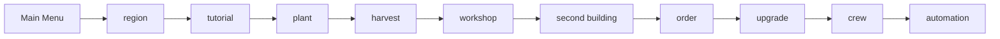

# Core loop

The path a new farm can play. The picture is [core-loop.svg](core-loop.svg).

Main Menu is Continue, My Farms, and New Game. Region is one of the four catalog rows, with its economy and play style. Tutorial is Mara's lesson through the barn loft. Plant and harvest are the Verdant Fiber plot. Workshop is the loom, Fiber Bundle or Fiber Cord. Second building is the packing bench, which wraps one Fiber Bundle into a Packed Textile. Order is the trail stall, the lane counter, or the crate counter. Upgrade is the loft and the shuttle rack. Crew is hire, wages, and one Efficiency gain. Automation is the loom rule, which starts the chosen fiber good when the plot is ready.
